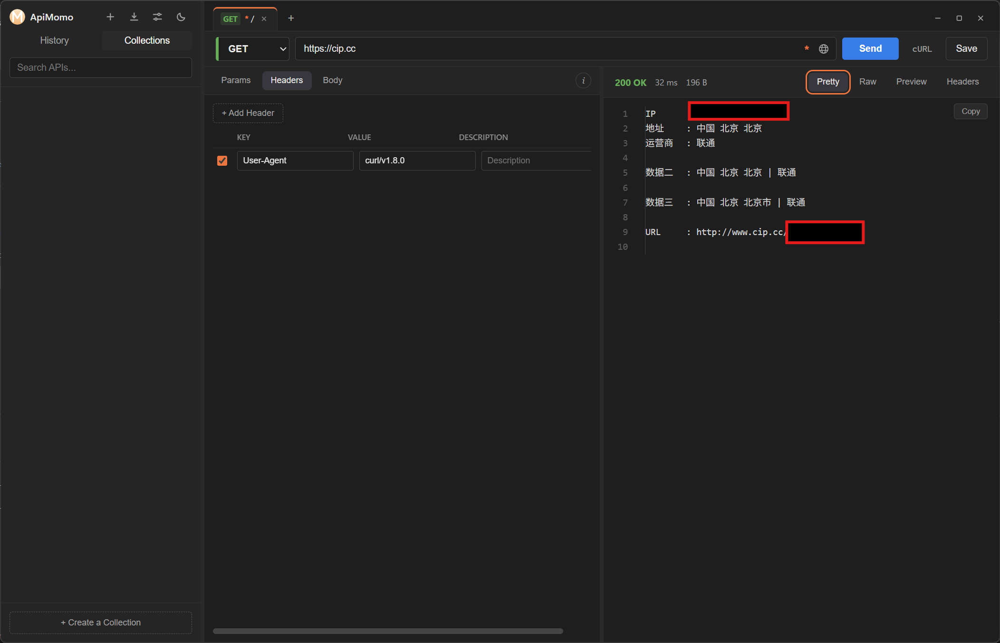
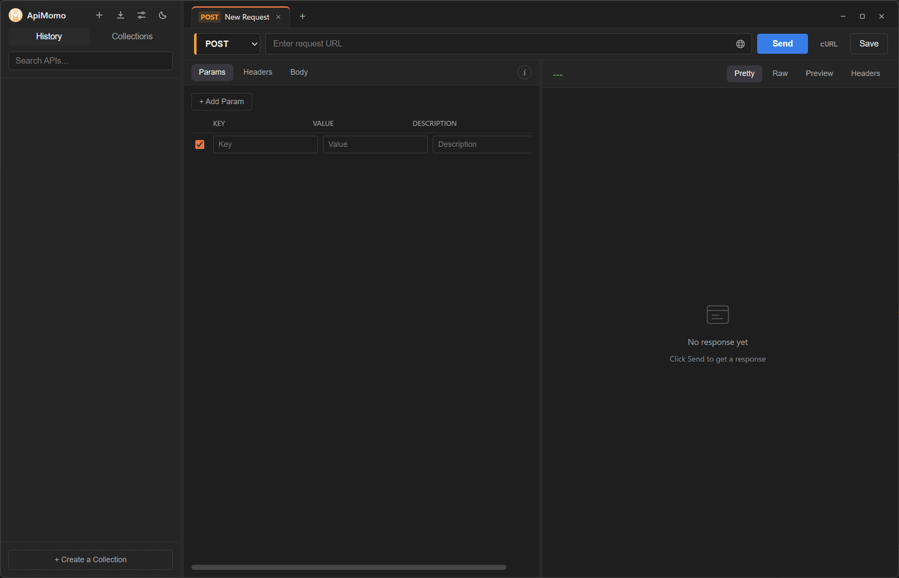
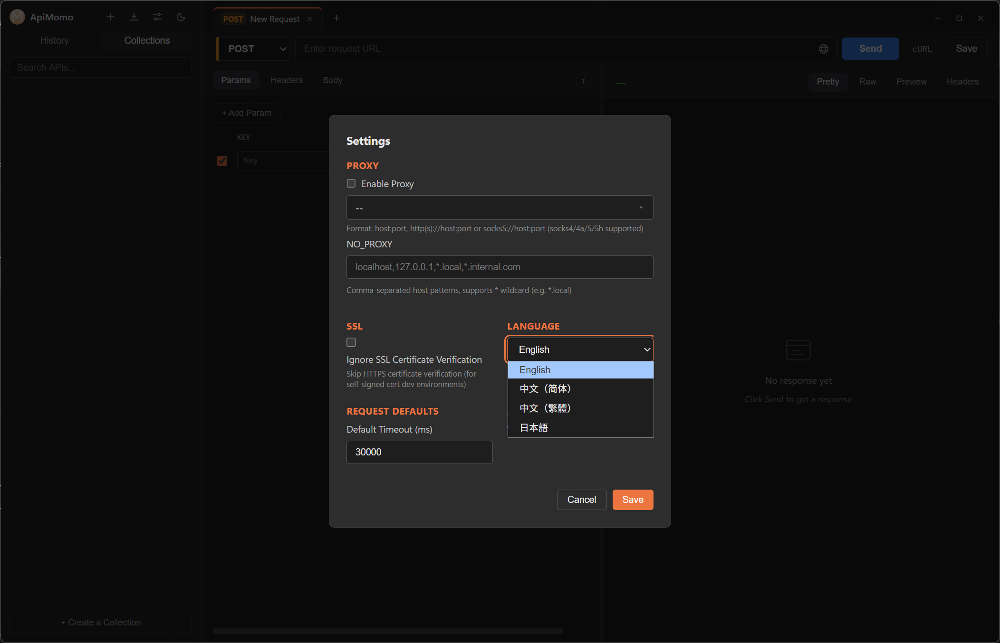

# ApiMomo

[简体中文](README.md) | [English](README.en.md) | [日本語](README.ja.md) | [繁體中文](README.zh-TW.md)

A lightweight desktop API debugging tool, built with Electron + Vite.

Current version: **v1.0.7**

## Screenshots

| Request Editing & Response Viewer | History |
| --- | --- |
|  |  |



## Features

### Request Editing

- **Request tabs** — Postman-style tab bar for editing multiple requests in parallel; drag to reorder, duplicate, rename
- **HTTP methods** — GET / POST / PUT / PATCH / DELETE / HEAD / OPTIONS, color-coded
- **Params / Headers / Body** — per-row checkboxes to include or exclude from sending, Header key autocomplete
- **Body types** — none / JSON (syntax highlight + Beautify) / text / x-www-form-urlencoded / multipart (file fields supported)
- **Raw request preview** — view the exact HTTP request assembled by real sending rules
- **Shortcuts** — `Ctrl+S` to save, `Ctrl+F` to search in Body or response

### Response Viewer

- Four views: Pretty / Raw / Preview / Headers
- Real-time rendering of SSE streaming responses, with thinking blocks
- **Media responses** — preview/play images, audio and video; over-limit hint above 20MB with confirm-to-download; right-click media to save as
- Cancel in-flight requests at any time
- One-click copy response body / copy as cURL

### History & Collections

- History saved automatically, grouped by date, multi-select and batch delete
- Collection management: rename requests, colorful tags, drag to move
- **Postman import / export** — collection v2.1 format, exported files can be re-imported, filename includes a timestamp
- **cURL conversion** — paste cURL to import (auto-detected in the URL bar), one-click copy as cURL

### Proxy & Network

- Proxy list management with quick switching, inline status icon in the URL bar
- NO_PROXY wildcard bypass
- SSL certificate error hints and an ignore-verification toggle

### UI

- Dark / light themes
- Four UI languages: 简体中文 / 繁體中文 / English / 日本語
- Frameless window, freely resizable panels with remembered layout
- Session restore: open tabs and unsaved content are preserved on exit

## Data Storage

All data is stored in the system user data directory, no administrator privileges required:

| Platform | Data file |
| --- | --- |
| Windows | `%APPDATA%\apimomo\data.json` |
| macOS | `~/Library/Application Support/apimomo/data.json` |
| Linux | `~/.config/apimomo/data.json` |

Uninstalling does not delete user data.

## Tech Stack

Electron · Vite · curlconverter · http-proxy-agent · https-proxy-agent

## Development

```bash
npm install
npm run dev
```

## Build

```bash
npm run dist:win           # Windows installer + ZIP
npm run dist:win:installer # Installer only (Setup.exe)
npm run dist:win:dir       # Runnable directory only (fast)
npm run dist:win:portable  # Windows Portable
npm run dist:mac           # macOS DMG + ZIP (Intel / Apple Silicon)
npm run dist:mac:dir       # Runnable directory only
npm run dist:linux         # Linux AppImage + deb
npm run dist:linux:dir     # Runnable directory only
```

Output directory: `release/{version}/`

> DMG cannot be cross-built from Windows; run `dist:mac` on macOS. Linux packages can be built on any platform.

## License

[PolyForm Noncommercial 1.0.0](LICENSE) — free to use, modify, and distribute for personal study, research, and other noncommercial purposes. **Commercial use (selling the software, embedding it in commercial products, or offering it as a paid service) requires a separate license.** Contact: igoso@qq.com

Copyright © 2026 igoso
