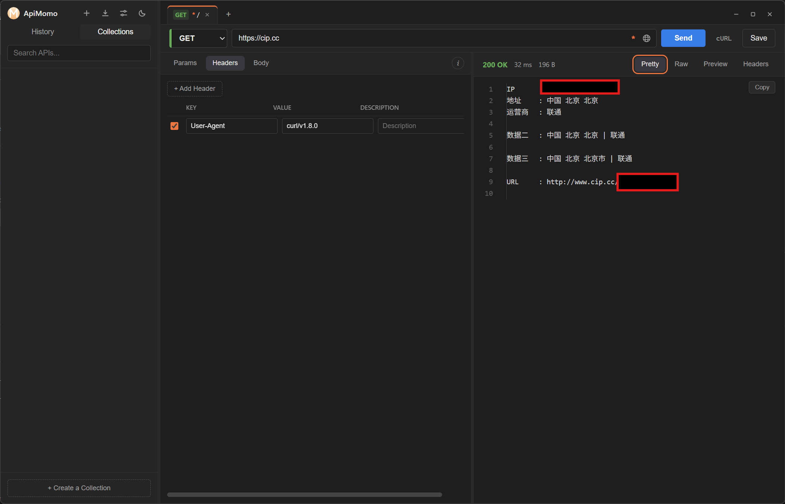
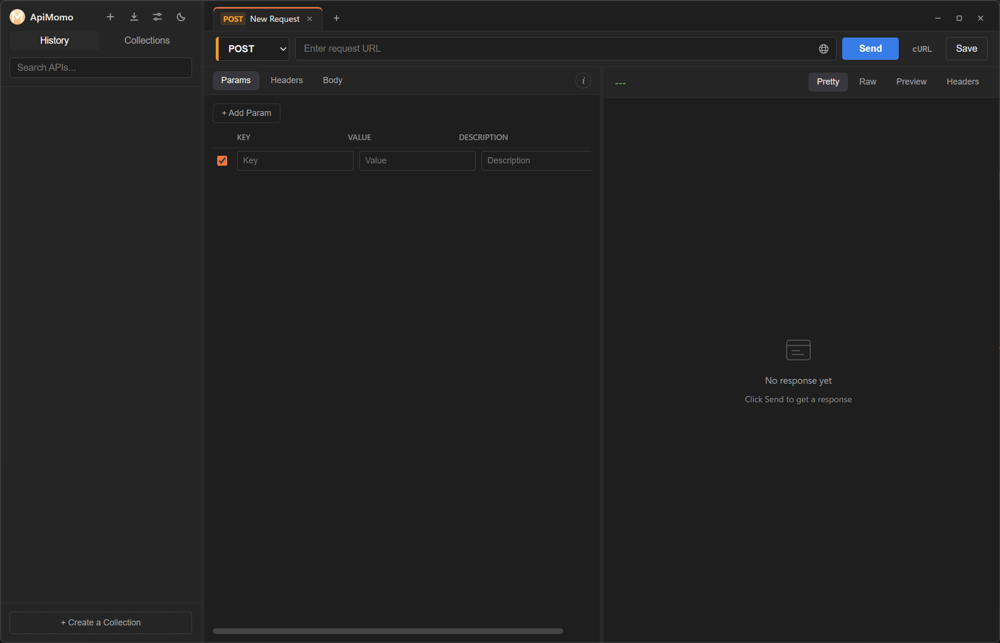
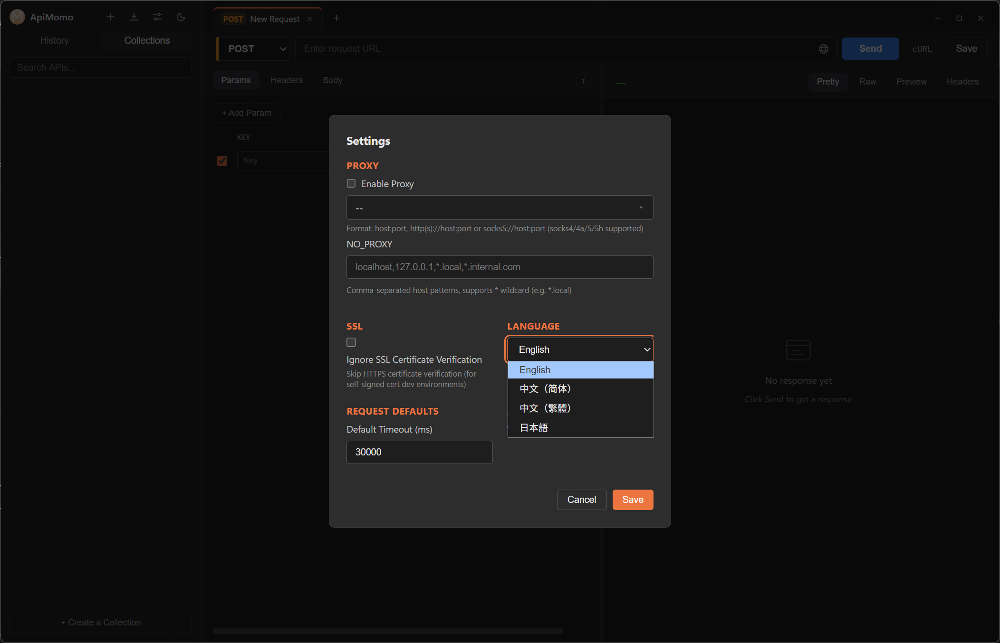

# ApiMomo

[简体中文](README.md) | [English](README.en.md) | [日本語](README.ja.md) | [繁體中文](README.zh-TW.md)

Electron + Vite で構築された軽量な API デバッグ用デスクトップツール。

現在のバージョン：**v1.0.7**

## スクリーンショット

| リクエスト編集とレスポンス表示 | 履歴 |
| --- | --- |
|  |  |



## 機能

### リクエスト編集

- **リクエストタブ** — Postman 風のタブバーで複数リクエストを並行編集。ドラッグ並べ替え、複製、リネームに対応
- **HTTP メソッド** — GET / POST / PUT / PATCH / DELETE / HEAD / OPTIONS、メソッドごとに色分け
- **Params / Headers / Body** — 行単位のチェックボックスで送信の要否を制御、Header キー入力補助
- **Body タイプ** — none / JSON（シンタックスハイライト + Beautify）/ text / x-www-form-urlencoded / multipart（ファイルフィールド対応）
- **生リクエストプレビュー** — 実際の送信ルールで組み立てられた HTTP リクエスト原文を表示
- **ショートカット** — `Ctrl+S` 保存、`Ctrl+F` Body やレスポンス内検索

### レスポンス表示

- Pretty / Raw / Preview / Headers の 4 ビュー
- SSE ストリーミングレスポンスをリアルタイム描画、thinking ブロック対応
- **メディアレスポンス** — 画像・音声・動画のプレビューと再生、20MB 超は確認後に直接ダウンロード、右クリックで名前を付けて保存
- リクエスト実行中はいつでもキャンセル可能
- レスポンス本文のコピーボタン / cURL としてコピー

### 履歴とコレクション

- 履歴は自動保存、日付ごとにグループ化、複数選択と一括削除に対応
- コレクション管理：リクエストのリネーム、カラータグ、ドラッグ移動
- **Postman インポート / エクスポート** — collection v2.1 形式、エクスポートしたファイルは再インポート可能、ファイル名にタイムスタンプ付き
- **cURL 相互変換** — cURL を貼り付けてインポート（URL バーで自動判定）、ワンクリックで cURL としてコピー

### プロキシとネットワーク

- プロキシリストの管理とクイック切り替え、URL バーにステータスアイコン
- NO_PROXY ワイルドカードによるバイパス
- SSL 証明書エラーの表示と検証無効スイッチ

### インターフェース

- ダーク / ライトテーマ
- 簡体中文 / 繁体中文 / English / 日本語 の 4 言語
- フレームレスウィンドウ、パネル幅は自由に調整可能でレイアウトを記憶
- セッション復元：終了時に開いているタブと未保存内容を保持

## データ保存

データはシステムのユーザーデータディレクトリに保存され、管理者権限は不要です：

| プラットフォーム | データファイル |
| --- | --- |
| Windows | `%APPDATA%\apimomo\data.json` |
| macOS | `~/Library/Application Support/apimomo/data.json` |
| Linux | `~/.config/apimomo/data.json` |

アンインストールしてもユーザーデータは削除されません。

## 技術スタック

Electron · Vite · curlconverter · http-proxy-agent · https-proxy-agent

## 開発

```bash
npm install
npm run dev
```

## ビルド

```bash
npm run dist:win           # Windows インストーラー + ZIP
npm run dist:win:installer # インストーラーのみ（Setup.exe）
npm run dist:win:dir       # 実行可能ディレクトリのみ（高速）
npm run dist:win:portable  # Windows ポータブル版
npm run dist:mac           # macOS DMG + ZIP（Intel / Apple Silicon）
npm run dist:mac:dir       # 実行可能ディレクトリのみ
npm run dist:linux         # Linux AppImage + deb
npm run dist:linux:dir     # 実行可能ディレクトリのみ
```

出力ディレクトリ：`release/{version}/`

> DMG は Windows からのクロスビルド非対応。`dist:mac` は macOS 上で実行してください。Linux パッケージは任意のプラットフォームでビルド可能です。

## License

[PolyForm Noncommercial 1.0.0](LICENSE)（非商用ライセンス）— 個人の学習・研究などの非商用目的では無料で利用・改変・配布できます。**商用利用（本ソフトウェアの販売、商用製品への組み込み、有料サービスとしての提供など）には別途ライセンスが必要です。** 連絡先：igoso@qq.com

Copyright © 2026 igoso
