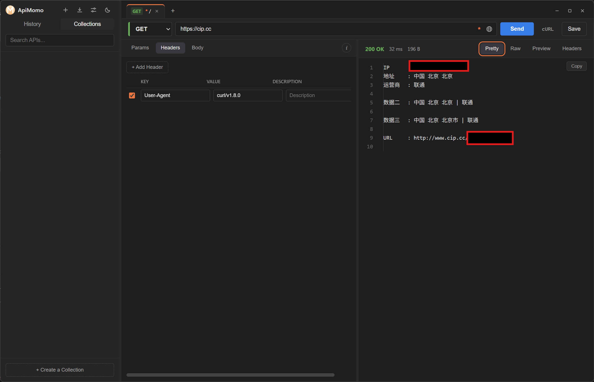
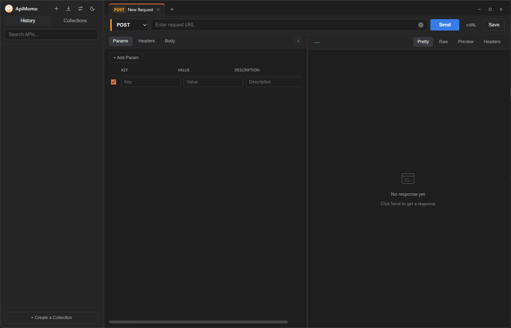
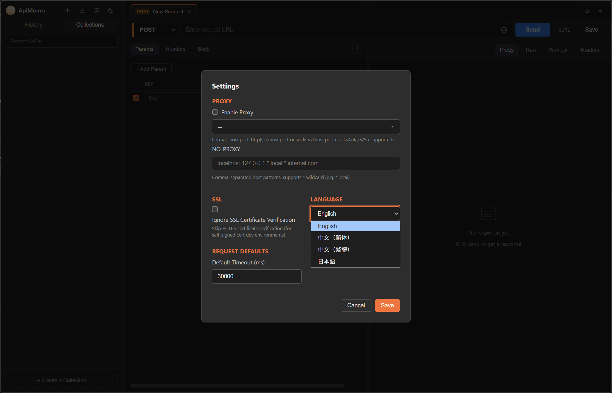

# ApiMomo

[简体中文](README.md) | [English](README.en.md) | [日本語](README.ja.md) | [繁體中文](README.zh-TW.md)

轻量级 API 调试桌面工具，基于 Electron + Vite 构建。

当前版本：**v1.0.7**

## 界面预览

| 请求编辑与响应查看 | 历史记录 |
| --- | --- |
|  |  |



## 功能特性

### 请求编辑

- **请求标签页** — 类 Postman 标签栏，并行编辑多个请求；支持拖拽排序、复制副本、重命名
- **HTTP 方法** — GET / POST / PUT / PATCH / DELETE / HEAD / OPTIONS，方法颜色区分
- **Params / Headers / Body** — 行级勾选控制是否发送，Headers Key 输入提示
- **Body 类型** — none / JSON（语法高亮 + Beautify）/ text / x-www-form-urlencoded / multipart（支持文件字段）
- **原始报文预览** — 查看按实际发送规则拼装的 HTTP 请求原文
- **快捷键** — `Ctrl+S` 保存，`Ctrl+F` 在 Body 或响应中查找

### 响应查看

- Pretty / Raw / Preview / Headers 四种视图
- SSE 流式响应实时渲染，支持 thinking 块
- **媒体响应** — 图片/音频/视频预览与播放，超 20MB 提示并可确认直接下载，右键另存为
- 请求进行中可随时取消
- 一键复制响应体 / 复制为 cURL

### 历史与集合

- 历史自动保存，按日期分组，支持多选与批量删除
- 集合管理：请求重命名、多色标签、拖拽移动
- **Postman 导入 / 导出** — collection v2.1 格式，导出文件可再导入还原，文件名带时间戳
- **cURL 互转** — 粘贴 cURL 导入（地址栏自动识别），一键复制为 cURL

### 代理与网络

- 代理列表管理与快速切换，地址栏内嵌状态图标
- NO_PROXY 通配符绕过
- SSL 证书错误提示与忽略验证开关

### 界面

- 暗黑 / 亮色双主题
- 简体中文 / 繁体中文 / English / 日本語 四语切换
- 无边框窗口，分栏宽度自由调整并自动记忆
- 会话恢复：退出时暂存已打开标签与未保存内容

## 数据存储

数据保存在系统用户数据目录，无需管理员权限：

| 平台 | 数据文件路径 |
| --- | --- |
| Windows | `%APPDATA%\apimomo\data.json` |
| macOS | `~/Library/Application Support/apimomo/data.json` |
| Linux | `~/.config/apimomo/data.json` |

卸载不会删除用户数据。

## 技术栈

Electron · Vite · curlconverter · http-proxy-agent · https-proxy-agent

## 开发

```bash
npm install
npm run dev
```

## 打包

```bash
npm run dist:win           # Windows 安装包 + ZIP
npm run dist:win:installer # 仅安装包（Setup.exe）
npm run dist:win:dir       # 仅可运行目录（快）
npm run dist:win:portable  # Windows Portable
npm run dist:mac           # macOS DMG + ZIP（Intel / Apple Silicon）
npm run dist:mac:dir       # 仅可运行目录
npm run dist:linux         # Linux AppImage + deb
npm run dist:linux:dir     # 仅可运行目录
```

输出目录：`release/{version}/`

> macOS 的 DMG 不支持从 Windows 交叉打包，`dist:mac` 需在 macOS 上执行；Linux 包可在任意平台构建。

## License

[PolyForm Noncommercial 1.0.0](LICENSE)（非商用许可）— 个人学习、研究及非商业用途可免费使用、修改和分发；**未经授权不得用于商业用途**（包括但不限于售卖本软件、集成进商业产品、以本软件对外提供商业服务）。商业授权请联系：igoso at qq.com

Copyright © 2026 igoso
