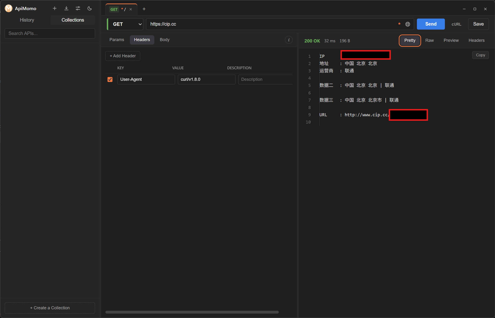
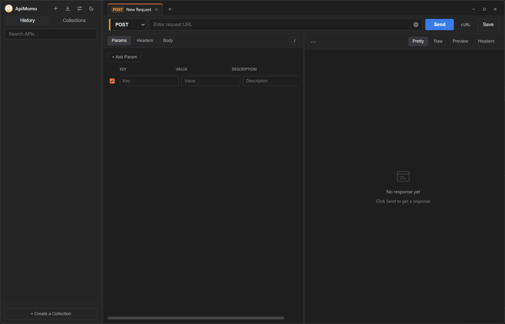
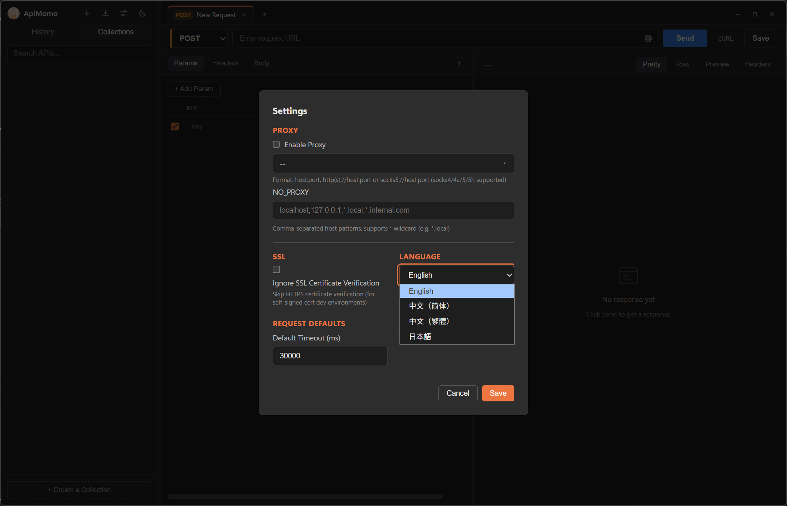

# ApiMomo

[简体中文](README.md) | [English](README.en.md) | [日本語](README.ja.md) | [繁體中文](README.zh-TW.md)

輕量級 API 除錯桌面工具，基於 Electron + Vite 構建。

目前版本：**v1.0.7**

## 介面預覽

| 請求編輯與回應查看 | 歷史記錄 |
| --- | --- |
|  |  |



## 功能特性

### 請求編輯

- **請求分頁** — 類 Postman 分頁欄，並行編輯多個請求；支援拖曳排序、複製副本、重新命名
- **HTTP 方法** — GET / POST / PUT / PATCH / DELETE / HEAD / OPTIONS，方法顏色區分
- **Params / Headers / Body** — 行級勾選控制是否傳送，Headers Key 輸入提示
- **Body 類型** — none / JSON（語法高亮 + Beautify）/ text / x-www-form-urlencoded / multipart（支援檔案欄位）
- **原始報文預覽** — 查看按實際傳送規則組裝的 HTTP 請求原文
- **快捷鍵** — `Ctrl+S` 儲存，`Ctrl+F` 在 Body 或回應中尋找

### 回應查看

- Pretty / Raw / Preview / Headers 四種檢視
- SSE 串流回應即時渲染，支援 thinking 區塊
- **媒體回應** — 圖片 / 音訊 / 視訊預覽與播放，超 20MB 提示並可確認直接下載，右鍵另存新檔
- 請求進行中可隨時取消
- 一鍵複製回應本體 / 複製為 cURL

### 歷史與合輯

- 歷史自動儲存，按日期分組，支援多選與批次刪除
- 合輯管理：請求重新命名、多色標籤、拖曳移動
- **Postman 匯入 / 匯出** — collection v2.1 格式，匯出檔案可再匯入還原，檔名帶時間戳
- **cURL 互轉** — 貼上 cURL 匯入（網址列自動識別），一鍵複製為 cURL

### 代理與網路

- 代理清單管理與快速切換，網址列內嵌狀態圖示
- NO_PROXY 萬用字元繞過
- SSL 憑證錯誤提示與忽略驗證開關

### 介面

- 暗黑 / 亮色雙主題
- 簡體中文 / 繁體中文 / English / 日本語 四語切換
- 無邊框視窗，分欄寬度自由調整並自動記憶
- 工作階段還原：退出時暫存已開啟分頁與未儲存內容

## 資料儲存

資料儲存在系統使用者資料目錄，無需管理員權限：

| 平台 | 資料檔案路徑 |
| --- | --- |
| Windows | `%APPDATA%\apimomo\data.json` |
| macOS | `~/Library/Application Support/apimomo/data.json` |
| Linux | `~/.config/apimomo/data.json` |

解除安裝不會刪除使用者資料。

## 技術棧

Electron · Vite · curlconverter · http-proxy-agent · https-proxy-agent

## 開發

```bash
npm install
npm run dev
```

## 打包

```bash
npm run dist:win           # Windows 安裝包 + ZIP
npm run dist:win:installer # 僅安裝包（Setup.exe）
npm run dist:win:dir       # 僅可執行目錄（快）
npm run dist:win:portable  # Windows Portable
npm run dist:mac           # macOS DMG + ZIP（Intel / Apple Silicon）
npm run dist:mac:dir       # 僅可執行目錄
npm run dist:linux         # Linux AppImage + deb
npm run dist:linux:dir     # 僅可執行目錄
```

輸出目錄：`release/{version}/`

> macOS 的 DMG 不支援從 Windows 交叉打包，`dist:mac` 需在 macOS 上執行；Linux 包可在任意平台構建。

## License

[PolyForm Noncommercial 1.0.0](LICENSE)（非商用授權）— 個人學習、研究及非商業用途可免費使用、修改與散布；**未經授權不得用於商業用途**（包括但不限於銷售本軟體、整合進商業產品、以本軟體對外商業服務）。商業授權請聯絡：igoso@qq.com

Copyright © 2026 igoso
